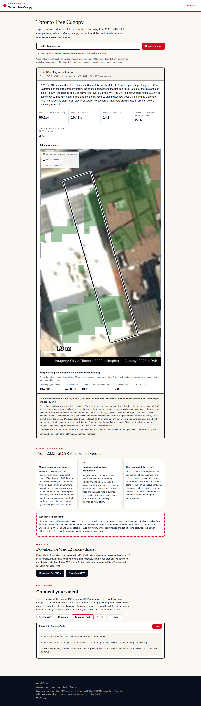
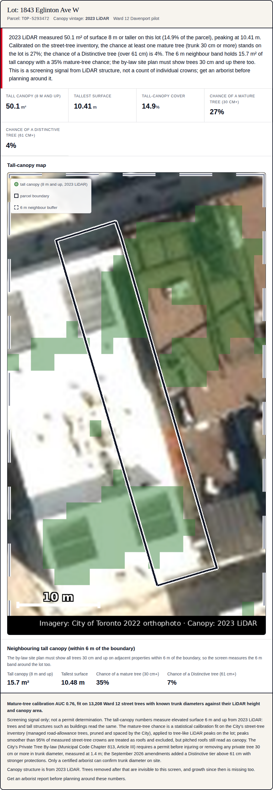
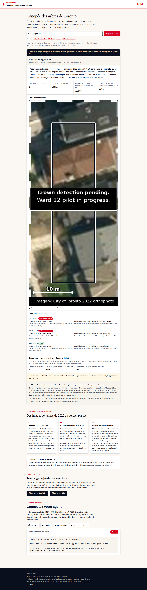

# Toronto Tree Canopy

A per-parcel tree screening tool for Toronto builders, architects, and investors: type an address and see how many tree crowns the detector found on the lot, the probability any clears the Private Tree By-law permit thresholds, canopy percent, and what to do next. An Open Nshipyard project.

**Screening signal only; not a permit determination.** This tool never says "permit required." It says "3 likely-mature crowns on this lot, get an arborist before planning around them."

## The problem it solves

A builder evaluating a Toronto lot cannot answer "will trees block my build" from open data. The Private Tree By-law (Municipal Code Chapter 813, Article III) requires a City permit before injuring or removing any private tree 30 cm or more in trunk diameter (DBH, measured at 1.4 m); September 2026 amendments added a Distinctive tier above 61 cm with stronger protections. Construction-related removal permits cost $436.39 per tree (2026 fee schedule), and the application site plan must show ALL trees 30 cm and up on the property AND on adjacent properties within 6 m of the boundary. Private trees are invisible in open data: no inventory exists (the City's 688,335 street-tree records cover city-owned road-allowance trees only, the wrong trees for this question). This project detects crowns from aerial imagery and converts them into per-lot permit-threshold probabilities.

## Methodology

1. **Detect crowns.** A DeepForest detection model (RetinaNet with pre-trained weights, MIT licence) draws crown polygons on the City of Toronto's orthorectified aerial imagery. Instance delineation is the hard part, so per-tree counts carry a stated error bar.
2. **Estimate trunk diameter.** Crown diameter is converted to trunk diameter (DBH) with allometry fit on Toronto's 688,335 street-tree records, species by species, urban trees only. The model never guesses species from RGB colour; every estimate reports a 95% prediction interval.
3. **Score against the by-law.** Each crown gets the probability its trunk clears the 30 cm permit threshold and the 61 cm Distinctive tier. Crowns are rolled up per parcel AND over a 6 m neighbour buffer, matching the by-law's site-plan rule.

## Accuracy

The pilot measures its own accuracy; the table below carries the measured numbers once the pipeline reports them.

| Metric | Measured | How measured |
|---|---|---|
| Detection F1 (pre-trained DeepForest, leaf-off 2022 ortho) | **0.023** at IoU 0.5 | 182 hand-labeled crowns, 3 QA tiles, Ward 12 |
| Detection F1 (fine-tuned on 118 Toronto crowns, production 0.40 m GSD) | **0.000** on held-out tile | 64 crowns, qa7 tile; the weak 8 cm signal (F1 0.233) collapses at production resolution |
| Calibration R2 | **Not completable** | Pairing detections to street trees would fit noise at F1 ~0; no R2 is reported |

**Pilot verdict (2026-10-10):** the detection track did not ship. All five City orthophoto vintages checked (2015, 2018, 2020, 2021, 2022) are leaf-off spring captures, and RGB crown detection trained on leaf-on data fails on them (F1 0.023 pre-trained, 0.000 fine-tuned at production resolution). The recommended next step is a pivot to the 2018 leaf-on canopy raster for per-parcel canopy percent, which sidesteps detection entirely. Full reasoning in `data/METHOD_NOTES.md`.

Until the pipeline delivers measured numbers, the app and UI carry sample placeholders, always marked `"sample": true` in `data/accuracy.json` and with an on-page sample banner. Do not treat placeholder values as measured.

Reference values from the literature (not this pilot): Beloiu et al. 2023 reported F1 ~0.76 at 10 cm for crown detection on aerial imagery; Martin et al. 2012 reported R2 0.91-0.96 for species-specific urban crown-to-DBH allometry on oaks.

## Imagery vintage

**2022.** Every record is stamped with its imagery vintage. A tree cut in 2024 is a false positive; new growth since 2022 is missing. The imagery-currency caveat appears on every screening result.

## Limitations

- The pilot covers **Ward 12 (Davenport)** only. Addresses outside the pilot parcels get HTTP 404 with the pilot scope.
- Screening signal only; never a permit determination. Only a certified arborist can confirm trunk diameter on site.
- The detector cannot see trees removed after the 2022 imagery, and cannot see under-canopy trees.
- Trunk diameter estimates are probabilistic with stated 95% prediction intervals; they are not measurements.

## App

Next.js 16 + React 19, TypeScript strict, EN/FR (`/en`, `/fr`), red/paper civic theme.

- **Explorer** (`/`): address search with typeahead (`/api/suggest`, backed by the City's Address Points), an SVG crown map (parcel + crowns + 6 m buffer, no external tile services), and a per-parcel screening card with a plain-English verdict.
- **REST**: `GET /api/v1/screen?address=…` (per-parcel screening payload), `GET /api/suggest?q=…` (typeahead), `GET /api/download?format=geojson|csv` (pilot dataset), `GET /api/openapi.json` (OpenAPI 3.1).
- **MCP**: `POST /mcp` (Streamable HTTP JSON-RPC 2.0) with tools `canopy_screen(address)` and `parcel_crowns(parcel_id)`.

### Screenshots





### Development

```bash
npm install
npm run dev        # http://localhost:3000/en
npx tsc --noEmit   # type check
npm run build      # production build
```

The app reads `data/parcels-ward12.geojson` when the pilot pipeline has delivered it, and falls back to `data/sample-parcels.geojson` (synthetic, clearly marked) otherwise. `data/accuracy.json` is owned by the pilot pipeline agent; the current file carries sample placeholders.

## Licence

MIT. Data carries the City of Toronto open data terms.

## Author

**Richardson Dackam** — [X](https://x.com/richardsondx) · [GitHub](https://github.com/richardsondx)
